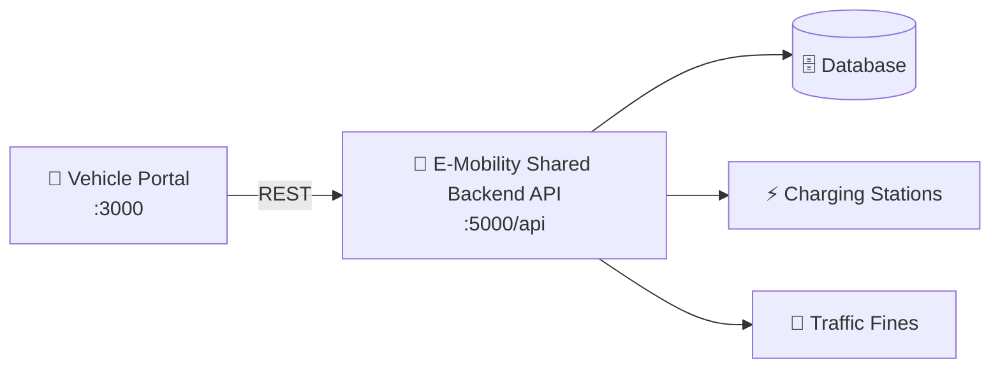

<div align="center">


<br/>


### ⚡ Mobile-First Citizen & EV Driver Digital Vehicle Portal
**for the National E-Mobility Ecosystem**

</div>

---

## 📱 Key Features

| | Feature | Description |
|---|---|---|
| 🚗 | **Digital Vehicle Wallet** | QR Code Revenue License, always in your pocket |
| 💳 | **Traffic Fines** | Real-time fines with evidence snapshot view |
| ⚖️ | **Disputes & Payments** | Online dispute submission and digital fine payment |
| ⚡ | **Charging Station Locator** | Live plugs, power & pricing |
| 🔋 | **Battery Telemetry** | SoC monitoring and range estimates |

---

## 🚀 Local Development

```bash
# Install dependencies
npm install

# Start development server on port 3000
npm run dev
```

---

## 🌐 Connected Architecture



- **Backend API:** Connects to the E-Mobility Shared Backend API on `http://localhost:5000/api`

---

<div align="center">
Made with ⚡ for a greener, smarter Sri Lanka
</div>
