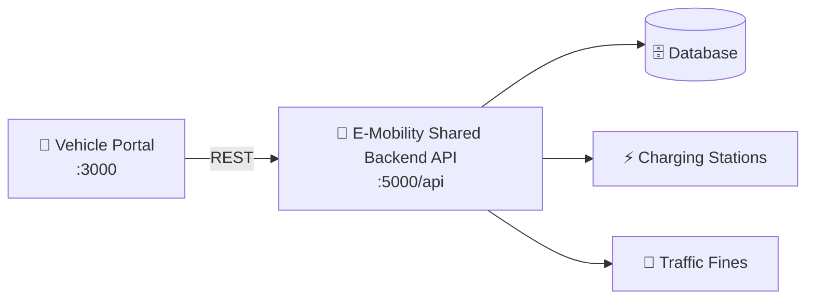

<svg width="1200" height="420" viewBox="0 0 1200 420" xmlns="http://www.w3.org/2000/svg" xmlns:c2pa="http://c2pa.org/manifest"><metadata><c2pa:manifest>AAAWgmp1bWIAAAAeanVtZGMycGEAEQAQgAAAqgA4m3EDYzJwYQAAABZcanVtYgAAAEdqdW1kYzJtYQARABCAAACqADibcQN1cm46YzJwYTo3ZGU3ZjU2OC1mMTczLTQ1NzgtOWIwOC0yY2U2OTM1OWI0MWMAAAADl2p1bWIAAAApanVtZGMyYXMAEQAQgAAAqgA4m3EDYzJwYS5hc3NlcnRpb25zAAAAALxqdW1iAAAARGp1bWRjYm9yABEAEIAAAKoAOJtxE2MycGEuaW5ncmVkaWVudC52MwAAAAAYYzJzaOsevsB0bjBoG0HamI3V8YAAAABwY2JvcqNpZGM6Zm9ybWF0bWltYWdlL3N2Zyt4bWxqaW5zdGFuY2VJRHgseG1wOmlpZDoyNjcwYWM2Ny05ZjQyLTRkZDQtODQwYS1mZGI5OTI0MjUzMmNscmVsYXRpb25zaGlwaHBhcmVudE9mAAAB4mp1bWIAAABBanVtZGNib3IAEQAQgAAAqgA4m3ETYzJwYS5hY3Rpb25zLnYyAAAAABhjMnNoEJXHTWn1M5kec1d1ZPTwjAAAAZljYm9yomdhY3Rpb25zgqJmYWN0aW9ua2MycGEub3BlbmVkanBhcmFtZXRlcnOha2luZ3JlZGllbnRzgaJjdXJseC1zZWxmI2p1bWJmPWMycGEuYXNzZXJ0aW9ucy9jMnBhLmluZ3JlZGllbnQudjNkaGFzaFggTuy0OKKAjBS9gguZYw7AVaOuVTokVgliN9aylCBwzsukZmFjdGlvbngdY29tLmFudGhyb3BpYy5jbGF1ZGUucHJvdmlkZWRqcGFyYW1ldGVyc6F4H2NvbS5hbnRocm9waWMub3JpZ2luLWNvbmZpZGVuY2VndW5rbm93bmtkZXNjcmlwdGlvbnhmQ2xhdWRlIHByb3ZpZGVkIHRoaXMgZmlsZSBhdCB0aGUgcmVxdWVzdCBvZiBhIHVzZXIgYW5kIG1heSBoYXZlIGNyZWF0ZWQgb3IgbW9kaWZpZWQgdGhlIGZpbGUgY29udGVudHMubXNvZnR3YXJlQWdlbnShZG5hbWVmQ2xhdWRlcmFsbEFjdGlvbnNJbmNsdWRlZPUAAADIanVtYgAAAEBqdW1kY2JvcgARABCAAACqADibcRNjMnBhLmhhc2guZGF0YQAAAAAYYzJzaFraryAbuZPZv2gEcTLZFFwAAACAY2JvcqVjYWxnZnNoYTI1NmNwYWRNAAAAAAAAAAAAAAAAAGRoYXNoWCDxtMTf0Q0E7/po+Fm+cci94DwK2sFFtFGrWG1lATJPY2RuYW1lbmp1bWJmIG1hbmlmZXN0amV4Y2x1c2lvbnOBomVzdGFydBiYZmxlbmd0aBkeBAAAAj5qdW1iAAAAJ2p1bWRjMmNsABEAEIAAAKoAOJtxA2MycGEuY2xhaW0udjIAAAACD2Nib3KlY2FsZ2ZzaGEyNTZpc2lnbmF0dXJleE1zZWxmI2p1bWJmPS9jMnBhL3VybjpjMnBhOjdkZTdmNTY4LWYxNzMtNDU3OC05YjA4LTJjZTY5MzU5YjQxYy9jMnBhLnNpZ25hdHVyZWppbnN0YW5jZUlEeCx4bXA6aWlkOmQwNzRkYjdlLWFmMDctNGM5Yy1hMmY1LWE3NDNkYjVhYTA1NXJjcmVhdGVkX2Fzc2VydGlvbnODomN1cmx4LXNlbGYjanVtYmY9YzJwYS5hc3NlcnRpb25zL2MycGEuaW5ncmVkaWVudC52M2RoYXNoWCBO7LQ4ooCMFL2CC5ljDsBVo65VOiRWCWI31rKUIHDOy6JjdXJseCpzZWxmI2p1bWJmPWMycGEuYXNzZXJ0aW9ucy9jMnBhLmFjdGlvbnMudjJkaGFzaFgg+UiPWw1YCiuJqLjFBKbT+YRr41mn2sk27XLNdFyIvDSiY3VybHgpc2VsZiNqdW1iZj1jMnBhLmFzc2VydGlvbnMvYzJwYS5oYXNoLmRhdGFkaGFzaFgg5TWxJeKY0c4d1Mk8Eiy0tlaAH3jeZJXAttfw5M6X1H10Y2xhaW1fZ2VuZXJhdG9yX2luZm+jZG5hbWVvQW50aHJvcGljIEZpbGVzZ3ZlcnNpb25lMS4wLjBrc3BlY1ZlcnNpb25lMi40LjAAABA4anVtYgAAAChqdW1kYzJjcwARABCAAACqADibcQNjMnBhLnNpZ25hdHVyZQAAABAIY2JvctKEWQISogEmGCFZAgowggIGMIIBjaADAgECAhRA5aAK7sI50L64g/oGQgU9Z1UTADAKBggqhkjOPQQDAzBJMRcwFQYDVQQKEw5BbnRocm9waWMsIFBCQzEuMCwGA1UEAxMlQW50aHJvcGljIENvbnRlbnQgQ3JlZGVudGlhbHMgUm9vdCBDQTAeFw0yNjA4MDcxODQzNTZaFw0yODA4MDYxOTQzNTZaMEQxFzAVBgNVBAoTDkFudGhyb3BpYywgUEJDMSkwJwYDVQQDEyBBbnRocm9waWMgQ2xhdWRlIENvbnRlbnQgU2lnbmluZzBZMBMGByqGSM49AgEGCCqGSM49AwEHA0IABJh6CmvLUBgFFNU0vUKlOVtE6djd17L5SuwX0LemFisBM3dkd/3cyjxFA3Qo5S46fX0/ihY0VZ7mfb9KF703t5OjWDBWMA4GA1UdDwEB/wQEAwIHgDAVBgNVHSUEDjAMBgorBgEEAYPoXgIBMAwGA1UdEwEB/wQCMAAwHwYDVR0jBBgwFoAUzlHiBIFOZFsj+OPEz5o+nMHXXMIwCgYIKoZIzj0EAwMDZwAwZAIwMXMdFJ4BetLLVY7ORuE9noqbbAZOZn/aArXyTwFAZfKrPzxF2vPoJNf1+UCdg1XGAjBwX1zd9WGqYkqmL5SFqw1QySjr1zJfpJM9+1rdDwSPLMOPOjKuiXjoU/pUUeG9RwmhY3BhZFkNngAAAAAAAAAAAAAAAAAAAAAAAAAAAAAAAAAAAAAAAAAAAAAAAAAAAAAAAAAAAAAAAAAAAAAAAAAAAAAAAAAAAAAAAAAAAAAAAAAAAAAAAAAAAAAAAAAAAAAAAAAAAAAAAAAAAAAAAAAAAAAAAAAAAAAAAAAAAAAAAAAAAAAAAAAAAAAAAAAAAAAAAAAAAAAAAAAAAAAAAAAAAAAAAAAAAAAAAAAAAAAAAAAAAAAAAAAAAAAAAAAAAAAAAAAAAAAAAAAAAAAAAAAAAAAAAAAAAAAAAAAAAAAAAAAAAAAAAAAAAAAAAAAAAAAAAAAAAAAAAAAAAAAAAAAAAAAAAAAAAAAAAAAAAAAAAAAAAAAAAAAAAAAAAAAAAAAAAAAAAAAAAAAAAAAAAAAAAAAAAAAAAAAAAAAAAAAAAAAAAAAAAAAAAAAAAAAAAAAAAAAAAAAAAAAAAAAAAAAAAAAAAAAAAAAAAAAAAAAAAAAAAAAAAAAAAAAAAAAAAAAAAAAAAAAAAAAAAAAAAAAAAAAAAAAAAAAAAAAAAAAAAAAAAAAAAAAAAAAAAAAAAAAAAAAAAAAAAAAAAAAAAAAAAAAAAAAAAAAAAAAAAAAAAAAAAAAAAAAAAAAAAAAAAAAAAAAAAAAAAAAAAAAAAAAAAAAAAAAAAAAAAAAAAAAAAAAAAAAAAAAAAAAAAAAAAAAAAAAAAAAAAAAAAAAAAAAAAAAAAAAAAAAAAAAAAAAAAAAAAAAAAAAAAAAAAAAAAAAAAAAAAAAAAAAAAAAAAAAAAAAAAAAAAAAAAAAAAAAAAAAAAAAAAAAAAAAAAAAAAAAAAAAAAAAAAAAAAAAAAAAAAAAAAAAAAAAAAAAAAAAAAAAAAAAAAAAAAAAAAAAAAAAAAAAAAAAAAAAAAAAAAAAAAAAAAAAAAAAAAAAAAAAAAAAAAAAAAAAAAAAAAAAAAAAAAAAAAAAAAAAAAAAAAAAAAAAAAAAAAAAAAAAAAAAAAAAAAAAAAAAAAAAAAAAAAAAAAAAAAAAAAAAAAAAAAAAAAAAAAAAAAAAAAAAAAAAAAAAAAAAAAAAAAAAAAAAAAAAAAAAAAAAAAAAAAAAAAAAAAAAAAAAAAAAAAAAAAAAAAAAAAAAAAAAAAAAAAAAAAAAAAAAAAAAAAAAAAAAAAAAAAAAAAAAAAAAAAAAAAAAAAAAAAAAAAAAAAAAAAAAAAAAAAAAAAAAAAAAAAAAAAAAAAAAAAAAAAAAAAAAAAAAAAAAAAAAAAAAAAAAAAAAAAAAAAAAAAAAAAAAAAAAAAAAAAAAAAAAAAAAAAAAAAAAAAAAAAAAAAAAAAAAAAAAAAAAAAAAAAAAAAAAAAAAAAAAAAAAAAAAAAAAAAAAAAAAAAAAAAAAAAAAAAAAAAAAAAAAAAAAAAAAAAAAAAAAAAAAAAAAAAAAAAAAAAAAAAAAAAAAAAAAAAAAAAAAAAAAAAAAAAAAAAAAAAAAAAAAAAAAAAAAAAAAAAAAAAAAAAAAAAAAAAAAAAAAAAAAAAAAAAAAAAAAAAAAAAAAAAAAAAAAAAAAAAAAAAAAAAAAAAAAAAAAAAAAAAAAAAAAAAAAAAAAAAAAAAAAAAAAAAAAAAAAAAAAAAAAAAAAAAAAAAAAAAAAAAAAAAAAAAAAAAAAAAAAAAAAAAAAAAAAAAAAAAAAAAAAAAAAAAAAAAAAAAAAAAAAAAAAAAAAAAAAAAAAAAAAAAAAAAAAAAAAAAAAAAAAAAAAAAAAAAAAAAAAAAAAAAAAAAAAAAAAAAAAAAAAAAAAAAAAAAAAAAAAAAAAAAAAAAAAAAAAAAAAAAAAAAAAAAAAAAAAAAAAAAAAAAAAAAAAAAAAAAAAAAAAAAAAAAAAAAAAAAAAAAAAAAAAAAAAAAAAAAAAAAAAAAAAAAAAAAAAAAAAAAAAAAAAAAAAAAAAAAAAAAAAAAAAAAAAAAAAAAAAAAAAAAAAAAAAAAAAAAAAAAAAAAAAAAAAAAAAAAAAAAAAAAAAAAAAAAAAAAAAAAAAAAAAAAAAAAAAAAAAAAAAAAAAAAAAAAAAAAAAAAAAAAAAAAAAAAAAAAAAAAAAAAAAAAAAAAAAAAAAAAAAAAAAAAAAAAAAAAAAAAAAAAAAAAAAAAAAAAAAAAAAAAAAAAAAAAAAAAAAAAAAAAAAAAAAAAAAAAAAAAAAAAAAAAAAAAAAAAAAAAAAAAAAAAAAAAAAAAAAAAAAAAAAAAAAAAAAAAAAAAAAAAAAAAAAAAAAAAAAAAAAAAAAAAAAAAAAAAAAAAAAAAAAAAAAAAAAAAAAAAAAAAAAAAAAAAAAAAAAAAAAAAAAAAAAAAAAAAAAAAAAAAAAAAAAAAAAAAAAAAAAAAAAAAAAAAAAAAAAAAAAAAAAAAAAAAAAAAAAAAAAAAAAAAAAAAAAAAAAAAAAAAAAAAAAAAAAAAAAAAAAAAAAAAAAAAAAAAAAAAAAAAAAAAAAAAAAAAAAAAAAAAAAAAAAAAAAAAAAAAAAAAAAAAAAAAAAAAAAAAAAAAAAAAAAAAAAAAAAAAAAAAAAAAAAAAAAAAAAAAAAAAAAAAAAAAAAAAAAAAAAAAAAAAAAAAAAAAAAAAAAAAAAAAAAAAAAAAAAAAAAAAAAAAAAAAAAAAAAAAAAAAAAAAAAAAAAAAAAAAAAAAAAAAAAAAAAAAAAAAAAAAAAAAAAAAAAAAAAAAAAAAAAAAAAAAAAAAAAAAAAAAAAAAAAAAAAAAAAAAAAAAAAAAAAAAAAAAAAAAAAAAAAAAAAAAAAAAAAAAAAAAAAAAAAAAAAAAAAAAAAAAAAAAAAAAAAAAAAAAAAAAAAAAAAAAAAAAAAAAAAAAAAAAAAAAAAAAAAAAAAAAAAAAAAAAAAAAAAAAAAAAAAAAAAAAAAAAAAAAAAAAAAAAAAAAAAAAAAAAAAAAAAAAAAAAAAAAAAAAAAAAAAAAAAAAAAAAAAAAAAAAAAAAAAAAAAAAAAAAAAAAAAAAAAAAAAAAAAAAAAAAAAAAAAAAAAAAAAAAAAAAAAAAAAAAAAAAAAAAAAAAAAAAAAAAAAAAAAAAAAAAAAAAAAAAAAAAAAAAAAAAAAAAAAAAAAAAAAAAAAAAAAAAAAAAAAAAAAAAAAAAAAAAAAAAAAAAAAAAAAAAAAAAAAAAAAAAAAAAAAAAAAAAAAAAAAAAAAAAAAAAAAAAAAAAAAAAAAAAAAAAAAAAAAAAAAAAAAAAAAAAAAAAAAAAAAAAAAAAAAAAAAAAAAAAAAAAAAAAAAAAAAAAAAAAAAAAAAAAAAAAAAAAAAAAAAAAAAAAAAAAAAAAAAAAAAAAAAAAAAAAAAAAAAAAAAAAAAAAAAAAAAAAAAAAAAAAAAAAAAAAAAAAAAAAAAAAAAAAAAAAAAAAAAAAAAAAAAAAAAAAAAAAAAAAAAAAAAAAAAAAAAAAAAAAAAAAAAAAAAAAAAAAAAAAAAAAAAAAAAAAAAAAAAAAAAAAAAAAAAAAAAAAAAAAAAAAAAAAAAAAAAAAAAAAAAAAAAAAAAAAAAAAAAAAAAAAAAAAAAAAAAAAAAAAAAAAAAAAAAAAAAAAAAAAAAAAAAAAAAAAAAAAAAAAAAAAAAAAAAAAAAAAAAAAAAAAAAAAAAAAAAAAAAAAAAAAAAAAAAAAAAAAAAAAAAAAAAAAAAAAAAAAAAAAAAAAAAAAAAAAAAAAAAAAAAAAAAAAAAAAAAAAAAAAAAAAAAAAAAAAAAAAAAAAAAAAAAAAAAAAAAAAAAAAAAAAAAAAAAAAAAAAAAAAAAAAAAAAAAAAAAAAAAAAAAAAAAAAAAAAAAAAAAAAAAAAAAAAAAAAAAAAAAAAAAAAAAAAAAAAAAAAAAAAAAAAAAAAAAAAAAAAAAAAAAAAAAAAAAAAAAAAAAAAAAAAAAAAAAAAAAAAAAAAAAAAAAAAAAAAAAAAAAAAAAAAAAAAAAAAAAAAAAAAAAAAAAAAAAAAAAAAAAAAAAAAAAAAAAAAAAAAAAAAAAAAAAAAAAAAAAAAAAAAAAAAAAAAAAAAAAAAAAAAAAAAAAAAAAAAAAAAAAAAAAAAAAAAAAAAAAAAAAAAAAAAAAAAAAAAAAAAAAAAAAAAAAAAAAAAAAAAAAAAAAAAAAAAAAAAAAAAAAAAAAAAAAAAAAAAAAAAAAAAAAAAAAAAAAAAAAAAAAAAAAAAAAAAAAAAAAAAAAAAAAAAAAAAAAAAAAAAAAAAAAAAAAAAAAAAAAAAAAAAAAAAAAAAAAAAAAAAAAAAAAAAAAAAAAAAAAAAAAAAAAAAAAAAAAAAAAAAAAAAAAAAAAAAAAAAAAAAAAAAAAAAAAAAAAAAAAAAAAAAAAAAAAAAAAAAAAAAAAAAAAAAAAAAAAAAAAAAAAAAAAAAAAAAAAAAAAAAAAAAAAAAAAAAAAAAAAAAAAAAAAAAAAAAAAAAAAAAAAAAAAAAAAAAAAAAAAAAAAAAAAAAAAAAAAAAAAAAAAAAAAAAAAAAAAAAAAAAAAAAAAAAAAAAAAAAAAAAAAAAAAAAAAAAAAAAAAAAAAAAAAAAAAAAAAAAAAAAAAAAAAAAAAAAAAAAAAAAAAAAAAAAAAAAAAAAAAAAAAAAAAAAAAAAAAAAAAAAAAAAAAAAAAAAAAAAAAAAAAAAAAAAAAAAAAAAAAAAAAAAPZYQAgpN2w1KOGQAsJbt4n3VWcF4/EahQx26ZrJkUSnqZX+3Va5CM8hO+rJI3LQY65s/0v4iC3qh97+7AN/n0pevPA=</c2pa:manifest></metadata>
  <defs>
    <linearGradient id="bg" x1="0" y1="0" x2="1" y2="1">
      <stop offset="0" stop-color="#050816"/>
      <stop offset="0.6" stop-color="#0b1f3a"/>
      <stop offset="1" stop-color="#063b3a"/>
    </linearGradient>
    <linearGradient id="neon" x1="0" y1="0" x2="1" y2="0">
      <stop offset="0" stop-color="#00f5a0"/>
      <stop offset="1" stop-color="#00d9f5"/>
    </linearGradient>
    <linearGradient id="phoneFront" x1="0" y1="0" x2="0" y2="1">
      <stop offset="0" stop-color="#16263f"/>
      <stop offset="1" stop-color="#0a1426"/>
    </linearGradient>
    <linearGradient id="floor" x1="0" y1="0" x2="0" y2="1">
      <stop offset="0" stop-color="#00f5a0" stop-opacity="0"/>
      <stop offset="1" stop-color="#00f5a0" stop-opacity="0.35"/>
    </linearGradient>
    <filter id="glow" x="-30%" y="-30%" width="160%" height="160%">
      <feGaussianBlur stdDeviation="6" result="b"/>
      <feMerge><feMergeNode in="b"/><feMergeNode in="SourceGraphic"/></feMerge>
    </filter>
    <filter id="shadow" x="-30%" y="-30%" width="160%" height="170%">
      <feDropShadow dx="0" dy="18" stdDeviation="14" flood-color="#000" flood-opacity="0.6"/>
    </filter>
    <text id="t1" font-family="Segoe UI, Arial Black, Arial, sans-serif" font-weight="900" font-size="78" letter-spacing="2">E-MOBILITY</text>
    <text id="t2" font-family="Segoe UI, Arial, sans-serif" font-weight="800" font-size="40" letter-spacing="14">VEHICLE PORTAL</text>
  </defs>

  <style>
    @keyframes float { 0%,100% { transform: translate(880px,40px) skewY(-6deg); } 50% { transform: translate(880px,24px) skewY(-6deg); } }
    @keyframes pulse { 0%,100% { opacity:.55 } 50% { opacity:1 } }
    @keyframes scan  { 0% { transform: translateY(0) } 100% { transform: translateY(150px) } }
    .phone { animation: float 4s ease-in-out infinite; }
    .bolt  { animation: pulse 1.6s ease-in-out infinite; }
    .scan  { animation: scan 2.4s linear infinite; }
  </style>

  <rect width="1200" height="420" rx="24" fill="url(#bg)"/>

  <!-- perspective grid floor -->
  <g stroke="#00f5a0" stroke-opacity="0.25" stroke-width="1">
    <rect x="0" y="300" width="1200" height="120" fill="url(#floor)" stroke="none"/>
    <line x1="0" y1="300" x2="1200" y2="300"/>
    <line x1="600" y1="300" x2="-200" y2="420"/><line x1="600" y1="300" x2="100" y2="420"/>
    <line x1="600" y1="300" x2="400" y2="420"/><line x1="600" y1="300" x2="600" y2="420"/>
    <line x1="600" y1="300" x2="800" y2="420"/><line x1="600" y1="300" x2="1100" y2="420"/>
    <line x1="600" y1="300" x2="1400" y2="420"/>
    <line x1="0" y1="325" x2="1200" y2="325"/><line x1="0" y1="355" x2="1200" y2="355"/>
    <line x1="0" y1="392" x2="1200" y2="392"/>
  </g>

  <!-- 3D extruded title -->
  <g transform="translate(60,170)">
    <g fill="#04594a">
      <use href="#t1" x="9" y="9"/><use href="#t1" x="8" y="8"/><use href="#t1" x="7" y="7"/>
      <use href="#t1" x="6" y="6"/><use href="#t1" x="5" y="5"/><use href="#t1" x="4" y="4"/>
      <use href="#t1" x="3" y="3"/><use href="#t1" x="2" y="2"/><use href="#t1" x="1" y="1"/>
    </g>
    <use href="#t1" fill="url(#neon)" filter="url(#glow)"/>
  </g>
  <g transform="translate(64,235)">
    <g fill="#0a2a55">
      <use href="#t2" x="5" y="5"/><use href="#t2" x="4" y="4"/><use href="#t2" x="3" y="3"/>
      <use href="#t2" x="2" y="2"/><use href="#t2" x="1" y="1"/>
    </g>
    <use href="#t2" fill="#ffffff"/>
  </g>
  <text x="66" y="280" font-family="Segoe UI, Arial, sans-serif" font-size="20" fill="#9fb4d0">Mobile-First Citizen &amp; EV Driver Portal · National E-Mobility Ecosystem</text>

  <!-- feature chips -->
  <g font-family="Segoe UI, Arial, sans-serif" font-size="15" font-weight="700" fill="#06101f">
    <rect x="66" y="320" width="130" height="34" rx="17" fill="#00f5a0"/><text x="88" y="342">Digital Wallet</text>
    <rect x="208" y="320" width="128" height="34" rx="17" fill="#00d9f5"/><text x="228" y="342">Fines &amp; Pay</text>
    <rect x="348" y="320" width="138" height="34" rx="17" fill="#7cf0ff"/><text x="368" y="342">Charging Map</text>
    <rect x="498" y="320" width="118" height="34" rx="17" fill="#b4ffd9"/><text x="518" y="342">Battery SoC</text>
  </g>

  <!-- floating 3D phone -->
  <g class="phone" filter="url(#shadow)">
    <g fill="#0a8f78">
      <rect x="14" y="14" width="190" height="330" rx="30"/><rect x="12" y="12" width="190" height="330" rx="30"/>
      <rect x="10" y="10" width="190" height="330" rx="30"/><rect x="8" y="8" width="190" height="330" rx="30"/>
      <rect x="6" y="6" width="190" height="330" rx="30"/><rect x="4" y="4" width="190" height="330" rx="30"/>
      <rect x="2" y="2" width="190" height="330" rx="30"/>
    </g>
    <rect width="190" height="330" rx="30" fill="url(#phoneFront)" stroke="url(#neon)" stroke-width="3"/>
    <rect x="68" y="10" width="54" height="8" rx="4" fill="#050816"/>
    <!-- wallet card -->
    <rect x="18" y="36" width="154" height="78" rx="12" fill="url(#neon)"/>
    <text x="30" y="62" font-family="Segoe UI, Arial" font-size="12" font-weight="800" fill="#06101f">DIGITAL REVENUE LICENSE</text>
    <text x="30" y="84" font-family="Segoe UI, Arial" font-size="11" fill="#06303a">EV-0000 · Valid</text>
    <!-- QR -->
    <g transform="translate(55,128)">
      <rect width="80" height="80" rx="8" fill="#fff"/>
      <g fill="#06101f">
        <rect x="8" y="8" width="22" height="22"/><rect x="50" y="8" width="22" height="22"/><rect x="8" y="50" width="22" height="22"/>
        <rect x="36" y="36" width="8" height="8"/><rect x="48" y="48" width="8" height="8"/><rect x="60" y="60" width="12" height="12"/>
        <rect x="36" y="12" width="8" height="8"/><rect x="12" y="36" width="8" height="8"/><rect x="60" y="38" width="8" height="8"/>
      </g>
      <rect class="scan" x="0" y="-4" width="80" height="3" fill="#00f5a0" opacity="0.8" transform="translate(0,0)"/>
    </g>
    <!-- battery -->
    <text x="22" y="248" font-family="Segoe UI, Arial" font-size="12" fill="#9fb4d0">Battery SoC</text>
    <rect x="22" y="256" width="146" height="14" rx="7" fill="#1b2c47"/>
    <rect x="22" y="256" width="104" height="14" rx="7" fill="url(#neon)"/>
    <text x="22" y="296" font-family="Segoe UI, Arial" font-size="13" font-weight="700" fill="#fff">~ 284 km range</text>
    <path class="bolt" d="M150 280 l-12 22 h9 l-4 18 l16 -26 h-9 z" fill="#ffe600" filter="url(#glow)"/>
  </g>
</svg>
<div align="center">


<br/>


### ⚡ Mobile-First Citizen & EV Driver Digital Vehicle Portal
**for the National E-Mobility Ecosystem**

</div>

---

## 📱 Key Features

| | Feature | Description |
|---|---|---|
| 🚗 | **Digital Vehicle Wallet** | QR Code Revenue License, always in your pocket |
| 💳 | **Traffic Fines** | Real-time fines with evidence snapshot view |
| ⚖️ | **Disputes & Payments** | Online dispute submission and digital fine payment |
| ⚡ | **Charging Station Locator** | Live plugs, power & pricing |
| 🔋 | **Battery Telemetry** | SoC monitoring and range estimates |

---

## 🚀 Local Development

```bash
# Install dependencies
npm install

# Start development server on port 3000
npm run dev
```

---

## 🌐 Connected Architecture



- **Backend API:** Connects to the E-Mobility Shared Backend API on `http://localhost:5000/api`

---

<div align="center">
Made with ⚡ for a greener, smarter Sri Lanka
</div>
